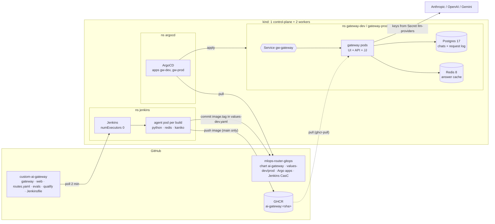
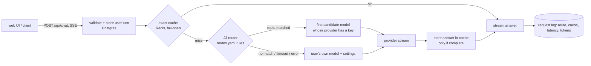
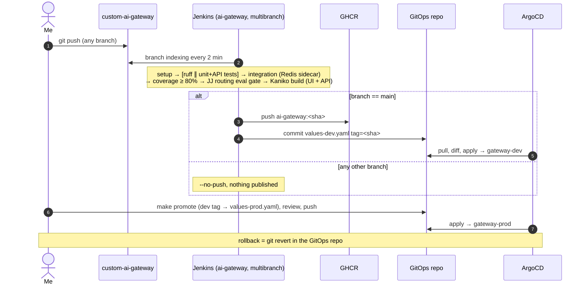

# MLOps platform for an AI gateway (kind + Jenkins + ArgoCD, GitOps)

The platform that tests, qualifies, ships and operates the **AI gateway** product
([custom-ai-gateway](https://github.com/ducthangng/custom-ai-gateway)): a chat UI and API that checks a
Redis cache, lets a router (**JJ**) pick the model and settings for each prompt, calls Anthropic /
OpenAI / Gemini (or an offline mock), streams the answer and stores every conversation and request log in
Postgres. JJ is a module inside the product (rules from `routes.yaml`) and has its own quality gate here.

Delivery is **GitOps**: Jenkins tests and builds, ArgoCD deploys, and Git is the only source of truth.
I built it to learn Kubernetes, CI/CD and MLOps from zero, on one laptop, by breaking things on purpose
(see [drills](#runbook)).

> **Status (2026-11-18):** the product moved to its own repo and routing became a module of it (it used to
> be a separate `router` service). Everything below marked *measured* was run on this laptop after that
> move; the full GitHub loop (push → Jenkins → GHCR → GitOps bump → ArgoCD) for the new image has **not**
> run yet: it starts when the three repos are pushed. Numbers of the retired router service are in
> [docs/archive/router-service](docs/archive/router-service/) and are not claims about the product.

---

## Three repos

| repo | what lives there | who watches it |
|---|---|---|
| **custom-ai-gateway** (product) | `gateway/` FastAPI app + plugins (JJ router, Redis cache), `routes.yaml`, `evals/`, `qualify/`, tests, `Jenkinsfile`; `web/` React UI | Jenkins (job `ai-gateway`, multibranch; job `qualify`) |
| **mlops-router-gitops** (desired state) | Helm chart `charts/ai-gateway`, `values-{dev,prod}.yaml`, ArgoCD apps, Jenkins JCasC + job XML | ArgoCD (apps `gw-dev`, `gw-prod`) |
| **mlops-skeleton** (this repo, platform) | `make up` bootstrap, Jenkins config sync, drills, CI log triage, runbook | you |

## Architecture



CI never talks to the cluster: there is no kubeconfig in Jenkins. Its only outputs are an image and a Git commit.
Secrets never go through Git: `make up` creates `ghcr-pull`, `postgres-auth` (random, once) and
`llm-providers` (from `.env`) in each `gateway-*` namespace.

## Request path (inside the product)



- **JJ** (`gateway/routing/`, plugin `gateway.plugins.rules_router:RulesRouter`): each route in `routes.yaml`
  has keywords and regexes; the route with the most distinct matches wins (ties: first route; below
  `min_score`: no route → the user's settings). A route lists **candidate models** from `catalog.yaml` in order
  of preference; the first whose provider has a key wins, so the same file works with any subset of keys.
- **Cache** (`gateway.plugins.redis_cache:RedisCache`): exact match over provider, model, params, routing mode and the
  whole conversation. One short timeout, no client retries: a slow or dead Redis is a miss (fail-open).
  Errors, refusals and truncated answers are never cached.
- **Postgres**: conversations, messages and one request-log row per chat (routing decision, cache result,
  latency, tokens, pipeline steps), shown in the UI.

## Release flow



A failing gate skips every later stage, so no image is pushed and no GitOps commit happens.

**Release qualification** (`qualify` job, `gateway/qualify/` in the product): a longer golden-regression run on a
release candidate: `config_lint → contract → routing → cache → load`, cheapest first, stop at the first
failure. Each stage writes a log and a JSON summary, compared with `qualify/golden/`; `qualify.diff` reports
**only** new failures and regressed metrics, with evidence lines. A stage whose inputs did not change is
skipped through a cache key. `SCENARIO=clean|bad|partial` demonstrates it.

| stage | what it proves |
|---|---|
| config_lint | `routes.yaml` parses, keywords are strings, regexes compile, **every candidate model exists in `catalog.yaml`** |
| contract | no endpoint/field removed vs the golden OpenAPI (the UI depends on it); a live SSE chat routed by JJ ends with `done` |
| routing | JJ's decision on 100 fixed prompts vs golden; every changed decision is listed |
| cache | a repeated chat is a hit with 0 output tokens; manual mode never reuses auto entries; Redis down → chats still ok |
| load | the real gateway under uvicorn, paced load, p95 and error rate vs golden |

## Results (measured after the move, laptop)

Apple Silicon laptop, Docker Desktop 28.5, kind `mlops` (k8s 1.37). Mock provider unless stated.

**Image** (`docker build --no-cache -f gateway/Dockerfile .` in the product repo; includes `npm ci` + Vite build of the UI):

| | value |
|---|---:|
| image size | 313 MB |
| `docker build --no-cache` | 12 s |
| `import torch` in the image | fails (not installed) |

**Tests** (`make gw-test`): 37 unit/API tests + 1 integration test on a real Redis 8; **84%** line coverage of the
`gateway` package (gate 80%). Provider SDK adapters (Anthropic/OpenAI/Gemini) are the least covered (21–32%).

**JJ routing** (`make gw-eval`; rules were written against `evals/dev.jsonl` only, same rules as the retired router):

| split | n | accuracy | errors |
|---|---:|---:|---|
| dev (rules written on it) | 52 | 100% | none |
| **test (held out)** | 48 | **93.75%** | math→none ×2, chitchat→none ×1 |

"none" means JJ keeps the user's model, so a miss costs a less suitable model, not a failed chat.
The CI gate fails if held-out accuracy drops more than 2 points below `evals/baseline.json`.

**Qualification** (`make gw-qualify SCENARIO=…`, local Redis 8, SQLite):

| scenario | result | wall time |
|---|---|---:|
| bad | fails at config_lint with 3 evidence lines (unquoted `null`, broken regex, unknown model `openai/gpt-404`); 4 stages not run | 0.19 s |
| partial | config_lint + contract pass; routing fails, 6 changed decisions listed, accuracy 0.97 → 0.91 (limit 0.95) | 1.3 s |
| clean | all 5 pass | 36 s |
| clean again | all 5 skipped (inputs unchanged) | 0.07 s |

Load stage (real gateway in uvicorn, 8 workers pacing 20 chats/s for 30 s after a 3 s warm-up, 30 prompts so
repeats hit Redis, mock provider at 2 ms/word, SQLite): 608 chats, p50 14.7 ms, p95 17.9 ms, 0 errors (golden);
a second run gave p50 13.9 ms, p95 18.1 ms. Cache stage: 100% of 20 repeated chats served from cache, 100% of chats ok with Redis down.

**In the cluster** (chart `ai-gateway` with the locally built image, ns `drills`): JJ routed `python TypeError in my
script` to route code; the same chat twice was a miss then a Redis hit; the UI is served at `/`.

**Not measured yet (needs the repos pushed):** Kaniko build time and memory for this image in Jenkins (the limit
is 2 Gi because the build also runs `npm ci`; the retired router image built in 18 s at 1 Gi), full CI pipeline
duration, and time from `git push` to a new pod running (`git push && date`, then
`kubectl -n gateway-dev get pods -w`).

## Runbook

```bash
cp .env.example .env     # once: GITHUB_USER / GITHUB_PAT, optional ANTHROPIC/OPENAI/GEMINI keys (gitignored)
make up                  # idempotent: cluster, ArgoCD, Jenkins (never upgraded), secrets, JCasC, jobs, apps
make status              # nodes, apps, pods
make ui                  # Jenkins :8080, ArgoCD :8443, gateway dev :8090 (+ passwords)
make jenkins | make argocd | make app      # one UI each (APP_ENV=prod APP_PORT=8091 make app)
make llm-key             # provider keys from .env -> Secret llm-providers, restart the gateways
make promote             # dev tag -> values-prod.yaml as a commit in the GitOps repo (review, push)
git -C ../mlops-gitops revert <sha>        # rollback, then push; ArgoCD does the rest
make gw-test | gw-eval | gw-qualify SCENARIO=bad     # product checks, same as CI
make jenkins-clean [CONFIRM=1] [JOB=ai-gateway]      # delete build history (dry run by default)
make drills              # list; make drill-NN breaks, make drill-NN-fix restores
uv run python -m tools.logtriage jenkins --job ai-gateway --branch main   # classify failures, flag slow builds
```

| symptom | first check | drill |
|---|---|---|
| build red | `logtriage jenkins` → category + evidence line | 01 test, 02 lint, 03 eval gate, 11 Kaniko OOM, 12 flaky |
| pods `ErrImagePull` | tag in `values-*.yaml` exists in GHCR? old pods still serve | 04 |
| someone "fixed" prod by hand | ArgoCD reverts it; change it in Git instead | 05 |
| chats slower, "cache unavailable" in the UI | Redis health; the gateway fails open | 06 |
| port-forward died | it was tunnelled to one pod; use the Service or reconnect | 07 |
| every chat fails with 500, pods Ready | Postgres; `/api/healthz` does not check the database | 08 |
| "Generate" step red with 401 | provider key in `.env` → `make llm-key` | 09 |
| branch builds fine, main fails at push | `jenkins/ghcr-creds` Secret present? | 10 |
| `CrashLoopBackOff`, exit 137 | memory limit (`kubectl describe`: OOMKilled) | 13 |
| rollout stuck, pod 0/1 | probe path failing; startupProbe gives 60 s before restarts | 14 |
| a cut-off answer replayed from cache | must not happen: only complete answers are stored | 15 |
| release candidate check | `qualify` job or `make gw-qualify`, `SCENARIO=clean` | 16 |

Drills verified after the move: 01, 02, 03 (mutations checked on a copy of the uncommitted product tree; they run on
the committed `HEAD`), 08, 09, 12, 13, 14, 15, 16. Not yet re-run after the move: 04, 05, 06, 07 (need gateway-dev/prod
deployed from GHCR) and 10, 11 (need the `ai-gateway` Jenkins job on GitHub).

## Repo layout

```
mlops-skeleton/ (this repo)            custom-ai-gateway/                mlops-router-gitops/
├── scripts/  bootstrap · lib ·        ├── Jenkinsfile                   ├── charts/ai-gateway/  values(-dev,-prod)
│             jenkins-configure ·      ├── gateway/                      │     templates: gateway, postgres, redis
│             jenkins-clean · drill    │   ├── gateway/ (app, plugins,   ├── argocd/  gw-dev.yaml, gw-prod.yaml
├── drills/   16 break/observe/restore │   │    routing = JJ)            └── jenkins/ values.yaml (fresh install),
├── tools/logtriage/  CI failure       │   ├── routes.yaml, catalog.yaml              casc/, jobs/*.xml,
│             triage + slow builds     │   ├── evals/  dev/test, gate                 qualify-cache-pvc.yaml
├── tests/    logtriage tests          │   ├── qualify/ stages, golden, scenarios, Jenkinsfile
└── docs/archive/router-service/       │   └── tests/
                                       └── web/  React UI
```

---

## What I learned (the hard way)

1. **`port-forward` is not load balancing.** It tunnels to a single pod and skips the Service. Delete that pod and the tunnel dies (drill 07).
2. **A bad image doesn't cause downtime.** A rolling update keeps the old pods until the new ones pass readiness, so `ImagePullBackOff` only blocks the rollout (drill 04).
3. **`helm upgrade --set` forgets earlier `--set` values.** My `replicaCount` silently went back to 2. Use values files or `--reuse-values`.
4. **Rolling back in the ArgoCD UI turns auto-sync off.** `kubectl apply` then reported `unchanged`, because its 3-way merge doesn't touch fields you never declared. Fix: write `automated.enabled: true` explicitly in Git.
5. **GitOps only manages what's in Git.** A Deployment I created by hand ran for 24 hours, and ArgoCD never saw it.
6. **PID 1 ignores SIGTERM.** My CI agent pod always took 30 s to stop. The agent containers now trap TERM.
7. **Kaniko got OOMKilled** in my old pipeline (push + `--cache=true`, PyTorch image). Rebuilding with `--no-push` at 4 Gi did *not* OOM, so the memory most likely went into compressing and uploading the 1.2 GB layer. The real fix was a smaller image.
8. **Look at the error pattern before fixing.** 100% of the old MiniLM routing errors were `X → default`, so the threshold was the problem, not the utterances.
9. **Eval leakage is a CI test.** `pytest` fails if any utterance appears in the eval set, or if dev and test overlap.
10. **Read a config file once.** `routes.yaml` was read twice, so the version in the cache key could disagree with the config actually running. The same bytes are now hashed and parsed.
11. **Dependencies die.** Bitnami moved its free images to a legacy repo in 2025, and Google archived Kaniko. I pinned maintained alternatives.
12. **Secrets are namespace-scoped, and PATs bypass 2FA.** Use one token per job with the least privilege it needs.
13. **Restarting Docker Desktop crash-looped Jenkins.** The chart's init step runs `yes n | cp -i` under `set -e`; coreutils ≥ 9.2 returns 1 when `cp -i` skips a file. Deleting the pod fixes it (jenkins_home is a PVC), and `make up` now does that automatically.
14. **Fail-open isn't free.** With Redis down, redis-py's default retries made every request seconds slower. One short timeout and no client retries; the product's cache plugin does the same.
15. **A host Redis on `127.0.0.1:6379` shadows Docker's `-p 6379`.** My benchmark wrote into the wrong Redis without any error. Local Redis now runs on `:6390`.
16. **`set -euo pipefail` can kill a script silently.** `cmd | head -n1` sends SIGPIPE to `cmd`; bash ≥ 5.2 expands `&` in `${v//pat/repl}`; and `[[ … ]] && x` as the last line of a function makes it return 1 and stops the script.
17. **JCasC can only read secrets mounted into the controller.** Without a `helm upgrade` there is no new mount, so credentials are synced from the k8s Secret over REST. `when { branch 'main' }` needs a multibranch job.
18. **A memory request above the limit is rejected by the API server**, so a drill's low limit never even started a pod.
19. **`openssl rand -hex` ends with a newline**, and `--from-file` keeps it. Postgres and the connection URL then disagreed about the password and the gateway crash-looped with "password authentication failed" (found by drill 08 on a fresh namespace).
20. **A process substitution `<(…)` can be read once.** Reusing it for a second namespace would have created an empty Secret; each `kubectl` call now gets its own.
21. **`envFrom` is read when the container starts.** Changing the Secret does nothing until the pod restarts (`make llm-key` restarts the gateways; drill 09 does too).
22. **A green health probe can hide a dead dependency.** With Postgres down every chat fails but `/api/healthz` stays 200 and the pods stay Ready (drill 08).

## Roadmap

- [ ] Push the three repos and run the full loop: GHCR image, GitOps bump, ArgoCD; measure push → pod running, Kaniko time/memory, CI duration.
- [ ] Readiness that checks Postgres (not liveness: restarting would not fix a dead database).
- [ ] Prometheus metrics in the product (latency per route, cache hit rate); today the numbers are in Postgres and the UI only.
- [ ] Per-client rate limiting and a semantic cache in the product (both existed in the retired router service; the plugin interfaces would need to grow).
- [ ] Schema migrations (Alembic) instead of `create_all` at startup, so 2 replicas starting together never race.
- [ ] Jenkins `junit` plugin on the next planned reinstall (reports are archived as XML for now).
- [ ] Webhooks instead of polling (needs a public endpoint).
