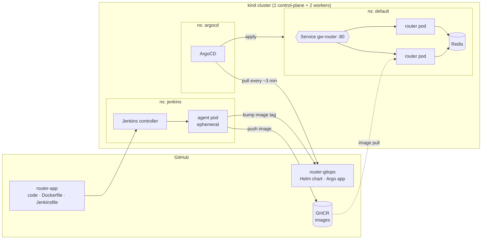
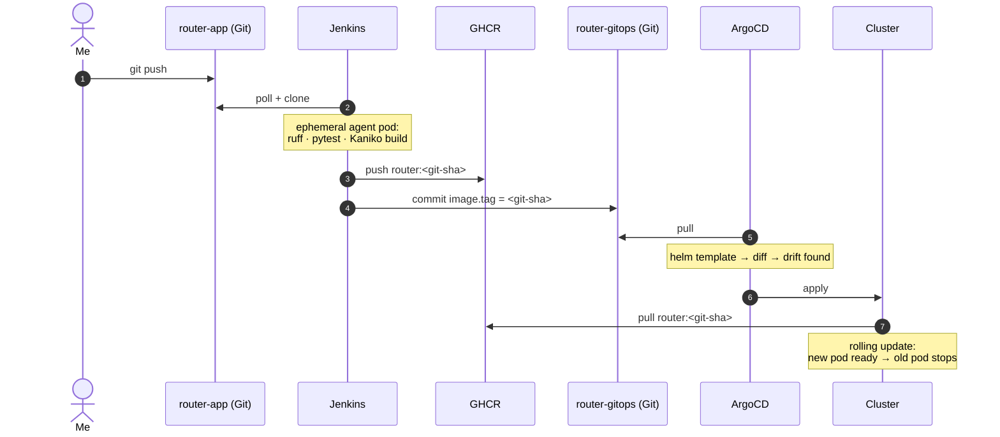
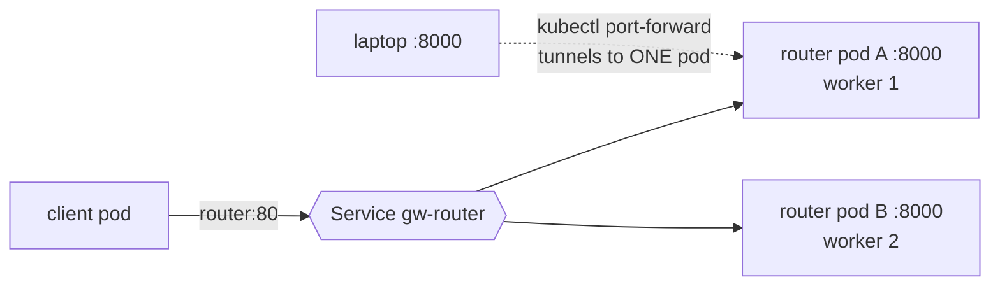

# AI Gateway — Semantic Router on Kubernetes with GitOps

A small gateway that reads a prompt, decides **which model and config** should handle it, and caches the decision in Redis. Everything ships through a **GitOps pipeline**: Jenkins builds, ArgoCD deploys, and Git is the only source of truth.

I built this to learn Kubernetes, CI/CD and MLOps from zero, on a laptop, by breaking things on purpose.

> **Status (Oct 2026):** router, Redis cache, Helm chart, ArgoCD GitOps and the GHCR registry are working. The Jenkins pipeline is built; I'm still tuning Kaniko's memory use. Rate limiting, semantic caching and calling real LLMs are on the [roadmap](#roadmap).

---

## Architecture



There is **no arrow from Jenkins into `ns: default`**. CI never touches the app's namespace. The only link between CI and CD is one Git commit that changes the image tag.

## Release flow



Rolling back a release means running `git revert` on the GitOps repo.

## Inside the cluster



## How routing works

1. Each route in `routes.yaml` has a few example prompts (utterances) plus a target model and config.
2. At startup, `all-MiniLM-L6-v2` embeds every utterance into a 384-dimensional vector.
3. At request time, the router embeds the prompt and scores it against each route using cosine similarity. It takes the **max** score per route.
4. If the best score is below `threshold`, the prompt falls back to `default`.

```yaml
threshold: 0.30
routes:
  - name: code
    target: { model: coder, temperature: 0.2, max_tokens: 1024 }
    utterances: ["why does my go program deadlock", "fix this typescript type error", ...]
```

**Caching (current):** Redis exact-match cache. The key is `hash(routes.yaml) + strategy + hash(prompt)`, so editing the config invalidates old entries automatically. The cache is **fail-open**: if Redis is down or slow (50 ms timeout), the router still answers, just without the cache.

## Results

| Metric | Value | Notes |
|---|---|---|
| Cache **hit** latency p50 / p95 | 0.12 ms / 0.21 ms | server-side, 100 prompts |
| Cache **miss** latency p50 / p95 | 25.3 ms / 66.5 ms | same 100 prompts, CPU only |
| Routing accuracy, max-sim | 50% | 100 labelled prompts, threshold 0.40, untuned |
| Routing accuracy, centroid | 19% | same set: every error was `X → default` |
| Image size | 1.4 GB | PyTorch CPU wheel; ONNX planned |
| `git push` → new pod running | _TODO_ | |

These are honest early numbers. Accuracy is low because the threshold hasn't been tuned yet, not because routing picks the wrong route. See lesson 8.

## Repo layout

```
router-app/                    router-gitops/
├── app/        main.py        ├── charts/router/
│               router.py      │   ├── Chart.yaml
├── routes.yaml                │   ├── values.yaml
├── evals/      prompts.jsonl  │   └── templates/  deployment · service · redis
│               run.py         └── argocd/gw.yaml
│               bench.py
├── tests/      test_routes_config.py
├── Dockerfile  (multi-stage, model baked in)
└── Jenkinsfile (k8s agent: python + kaniko)
```

## Quickstart

```bash
kind create cluster --config kind-config.yaml
helm install argocd argo/argo-cd -n argocd --create-namespace
helm install jenkins jenkins/jenkins -n jenkins --create-namespace -f jenkins-values.yaml
kubectl apply -f router-gitops/argocd/gw.yaml      # ArgoCD takes it from here
kubectl port-forward svc/gw-router 8000:80
curl -s localhost:8000/route -H 'content-type: application/json' \
  -d '{"prompt":"why does my go program deadlock"}'
```

---

## What I learned (the hard way)

1. **`port-forward` is not load balancing.** It tunnels to a single pod and skips the Service. Delete that pod and the tunnel dies.
2. **A bad image doesn't cause downtime.** Rolling update keeps the old pods until new ones pass readiness, so `ImagePullBackOff` only blocks the rollout.
3. **`helm upgrade --set` forgets earlier `--set` values.** My `replicaCount` silently went back to 2. Use values files or `--reuse-values`.
4. **Rolling back in the ArgoCD UI turns auto-sync off.** `kubectl apply` then reported `unchanged`, because its 3-way merge doesn't touch fields you never declared. Fix: write `automated.enabled: true` explicitly in Git.
5. **GitOps only manages what's in Git.** A Deployment I created by hand ran for 24 hours, and ArgoCD never saw it.
6. **PID 1 ignores SIGTERM.** My CI agent pod always took 30 s to stop: `sleep` ignored the signal until the grace period ended in SIGKILL (exit 137).
7. **Kaniko got OOMKilled** while snapshotting the 1.2 GB PyTorch layer. `--compressed-caching=false` and `--snapshot-mode=redo` help, but the real fix is a smaller image.
8. **Look at the error pattern before fixing.** 100% of routing errors were `X → default`, so the threshold was the problem, not the utterances. The same threshold also means different things for centroid and max-sim.
9. **Eval leakage is a CI test.** `pytest` fails if any utterance also appears in the eval set.
10. **The linter pointed at the wrong line but found a real bug.** `ASYNC230` led me to see that `routes.yaml` was read twice, so the cache key could disagree with the config actually running.
11. **Dependencies die.** Bitnami moved its free images to a legacy repo in 2025 and Google archived Kaniko. I pinned maintained alternatives.
12. **Secrets are namespace-scoped, and PATs bypass 2FA.** Use one token per job with the least privilege it needs.

## Roadmap

- [ ] Forward requests to real LLM backends (the router currently returns the routing decision only)
- [ ] Per-client rate limiting (token bucket in Redis)
- [ ] Semantic cache (embedding + vector search), with a similarity threshold tuned against false hits
- [ ] Per-environment values (`values-dev.yaml`, `values-prod.yaml`)
- [ ] One-command bootstrap (`make up`) in Bash
- [ ] Tune the threshold on a held-out split; report test accuracy
- [ ] ONNX Runtime instead of PyTorch to shrink the image
- [ ] Circuit breaker for Redis; webhooks instead of polling