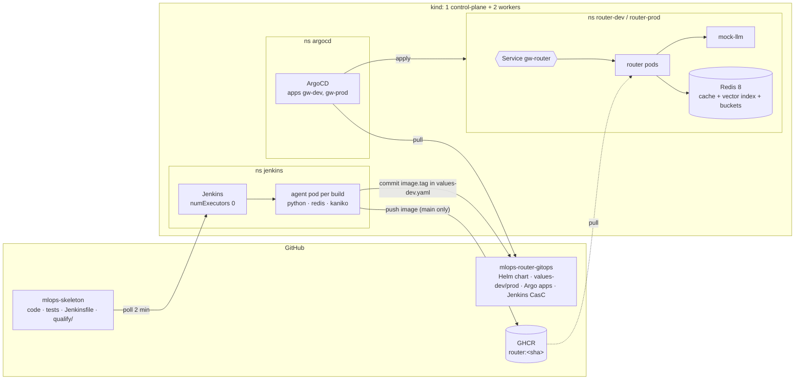
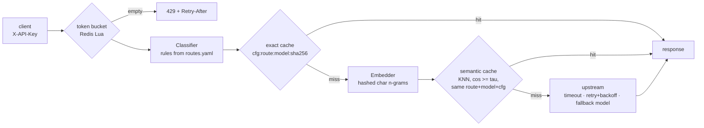
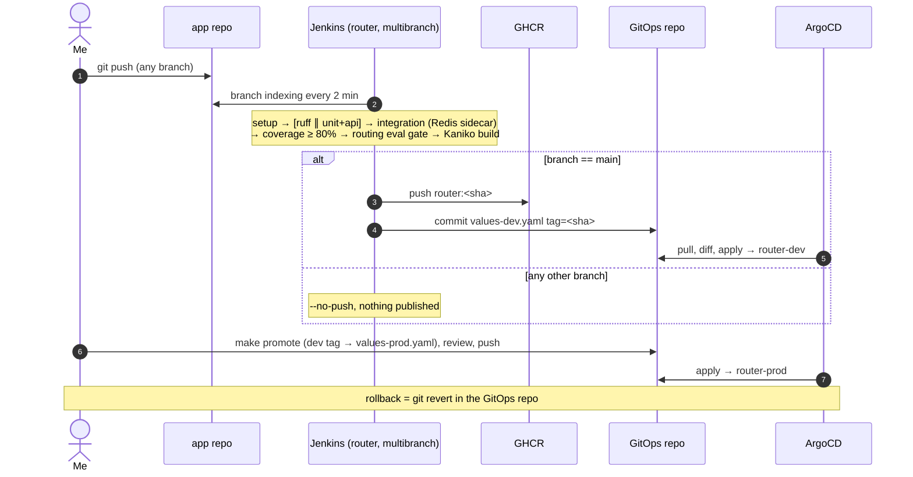

# AI Gateway on Kubernetes with GitOps

A small LLM gateway. For every prompt it **classifies** the request, picks a model and config for that route, applies a **per-client rate limit**, checks an **exact and a semantic cache** in Redis, and only then calls an OpenAI-compatible backend, with retries and a fallback model. Delivery is **GitOps**: Jenkins tests and builds, ArgoCD deploys, and Git is the only source of truth.

I built it to learn Kubernetes, CI/CD and MLOps from zero, on one laptop, by breaking things on purpose (see [drills](#runbook)). The "AI" is deliberately a black box behind two small interfaces, so the platform work can be judged on its own.

> **Status (Nov 2026):** everything below runs locally on kind and is verified, including Jenkins builds, ArgoCD syncs and rollback by `git revert`. The local runs used a local git mirror. The one step not yet run end to end is GitHub → Jenkins → GHCR push → GitOps bump, because it needs the branches pushed ([TODO](#results)).

---

## Architecture



CI never talks to the cluster: there is no kubeconfig in Jenkins and no arrow from Jenkins into the app namespaces. Its only outputs are an image and a Git commit.

## Request path



- **Classifier** (`app/classifier.py`): `classify(prompt) -> route`. The default `RuleClassifier` scores each route by how many of its keywords/regexes match. The highest score wins, ties go to the first route, and a score below `min_score` falls back to `default`. A MiniLM implementation exists as an optional extra (`CLASSIFIER=minilm`) and is **not** in the image.
- **Embedder** (`app/embedder.py`): `embed(text) -> unit vector`. The default uses signed feature hashing of character 3–5-grams (numpy only). It captures spelling similarity, not meaning, which is why τ is chosen on a near-miss eval set.
- **Caches** (`app/cache.py`): the exact key contains the hash of `routes.yaml`, so editing the config invalidates old entries. The semantic cache uses Redis vector search (Redis 8 query engine, FLAT index, KNN 1 with a TAG pre-filter) and falls back to brute-force numpy cosine over a bounded list on Redis without `FT.*`. Both caches are **fail-open** with one 50 ms timeout and no client retries. Answers produced by a fallback model are never cached.
- **Rate limit** (`app/ratelimit.py`): one Lua script, so the read-modify-write is atomic across pods, and it uses `redis TIME` so every pod shares one clock. `RATE_LIMIT_FAIL_MODE=open` (default) lets requests through when Redis is down; `closed` returns 503. Open suits an internal gateway; closed suits a limit that protects a paid budget.
- **Metrics** (`GET /metrics`): `gateway_request_duration_seconds{route,cache}`, `gateway_cache_hits_total{type=exact|semantic}`, `gateway_cache_misses_total`, `gateway_rate_limited_total`, `gateway_upstream_calls_total{model}`, `gateway_upstream_errors_total{model,reason}`, `gateway_cache_errors_total{op}`, `gateway_upstream_fallbacks_total`. Pods carry `prometheus.io/scrape` annotations; no Prometheus server is installed (see roadmap).

## Release flow



A failing build never reaches the cluster. If any gate fails, the later stages are skipped (`Stage "Build image" skipped due to earlier failure(s)`, real log in `tools/logtriage/samples/real_test_drill01.log`), so no image is pushed and no GitOps commit happens.

**Release qualification** (`qualify` job, `qualify/`): a longer golden-regression run on a release candidate. It runs `config_lint → contract → routing → cache → load`, cheapest first, and stops at the first failure. Each stage writes a log plus a JSON summary and is compared with `qualify/golden/`. `logtriage qualify-diff` reports **only** new failures and regressed metrics, with evidence lines. A stage whose input files did not change is skipped through a cache key. `SCENARIO=clean|bad|partial` demonstrates it.

## Results

Every number below was measured during this work. The setup is next to each number. Raw reports are in `docs/results/`.

**Image and build** (Apple Silicon laptop, Docker 28, `docker build --no-cache` with the base image already pulled):

| | before (PyTorch + MiniLM baked in) | after (rules + hashing embedder) |
|---|---:|---:|
| image size | 1.45 GB (1,447,666,294 B) | 250 MB (249,839,278 B) |
| `docker build --no-cache` | 50 s | 7 s |
| Kaniko in kind, `--no-push`, `--snapshot-mode=redo --compressed-caching=false` | 184 s (4 Gi limit) | 18 s (1 Gi limit) |
| Kaniko in kind, `--no-push`, default flags | 128 s (4 Gi limit, no OOM) | not measured |
| gateway RSS at idle (`docker stats`) | not measured | 59 MiB |

**CI** (kind on the laptop, Jenkins agent pod per build):
- Full branch pipeline (setup, lint ∥ unit+api tests, integration tests on a real Redis, coverage gate 80%, eval gate, Kaniko build): **34–57 s** over builds #3–#7 of `router/feat%2Fcv-parity`. At the last commit: 79 unit+api + 6 integration tests, 95% combined coverage of `app/`, `mock_llm/`, `tools/` (`make cov`).
- Kaniko with `KANIKO_MEMORY=150Mi`: OOMKilled, exit 137, classified `oom` by logtriage (drill 11).
- `qualify` (100 rps load stage for 30 s): **48–55 s** uncached, **15–16 s** when every stage is reused from the cache, and **14–15 s** for `SCENARIO=bad`, which fails at config_lint before the other 4 stages run.

**Routing** (`make eval`; rules were written against `evals/dev.jsonl` only):

| split | n | accuracy | errors |
|---|---:|---:|---|
| dev (rules written on it) | 52 | 100% | none |
| **test (held out)** | 48 | **93.75%** | math→default ×2, chitchat→default ×1 |

The CI gate fails if held-out accuracy drops more than 2 points below `evals/baseline.json`.

**Semantic cache threshold** (`make semantic-eval`: 36 paraphrase pairs that should hit, 36 near-miss pairs that must not; hit = cos ≥ τ AND same route):

| τ | paraphrase hit rate | false-hit rate |
|---:|---:|---:|
| 0.85 | 69.4% | 27.8% |
| 0.90 | 50.0% | 11.1% |
| 0.92 | 41.7% | 2.8% |
| **0.95 (chosen)** | **27.8%** | **0.0%** |

At τ = 0.95 the hashing embedder only catches surface edits: 7/8 case/punctuation pairs, 2/6 reorders, 1/8 filler words, and 0 synonyms or typos. Number edits are the dangerous near misses ("derivative of x^2" vs "x^3" has cos 0.906). The optional MiniLM embedder catches more paraphrases (55.6% at 0.95), but **no τ below 1.0 is free of false hits** on this set: "convert json array to csv" vs "convert csv to json array" scores 0.997. Full tables: `docs/results/semantic_tau_*.md`.

**Replay benchmark** (`make bench`): 300 sequential requests, seed 7. Mix: 149 unique, 88 exact repeats, 63 paraphrases of earlier prompts. Mock LLM latency is 200 ms + U(0, 50) ms. τ = 0.95. One uvicorn worker, Redis 8 in Docker, client on the same laptop.

| config | LLM calls | calls avoided | miss p50 / p95 | exact hit p50 / p95 | semantic hit p50 / p95 |
|---|---:|---:|---:|---:|---:|
| no cache | 300 | 0% | 236 / 257 ms | – | – |
| exact only | 164 | 45.3% | 240 / 262 ms | 5.3 / 7.6 ms | – |
| exact + semantic | 161 | 46.3% | 245 / 266 ms | 5.4 / 7.3 ms | 7.0 / 11.5 ms |

What this means for this workload: almost all of the saving comes from the exact cache, and the semantic layer adds 3 avoided calls (+1 point). The cache adds about 5–9 ms to a miss (two Redis lookups, the embedding and two writes). One semantic hit served a near-identical prompt ("good morning, have a great day!" got the answer cached for "good morning have a great day"). That is the same intent, but it is listed for review rather than auto-accepted.

**Resilience** (drills, in-cluster, through the Service):
- Redis paused (`CLIENT PAUSE`): requests still return 200; latency went from 0.29 s to 0.50 s (5 Redis calls × 50 ms timeout).
- Manual `kubectl scale --replicas=4`: ArgoCD selfHeal restored `replicas: 1` within 10 s.
- Bad image tag committed to Git: the new pod sat in `ErrImagePull` while the old pod kept serving 200; `git revert` rolled it back.
- Load stage in Jenkins (100 rps offered, 8 normal clients + 1 noisy client limited to 2/s): p95 4.4–4.9 ms; 0% 429 for normal clients and 89% for the noisy one.

**TODO (needs the branches pushed):** time from `git push` to a new pod running. Measure it with `git push && date` and `kubectl -n router-dev get pods -w`.

## Runbook

```bash
cp .env.example .env    # once: fill GITHUB_USER / GITHUB_PAT (gitignored)
make up                 # idempotent: cluster, ArgoCD, Jenkins (never upgraded), secrets, JCasC, jobs, apps
make status                              # nodes, apps, pods
make ui                                  # Jenkins :8080, ArgoCD :8443, gateway dev :8000/docs (+ passwords)
make llm-key                             # UPSTREAM_API_KEY from .env -> Secret llm-upstream, restart gateways
make passwords                           # ArgoCD + Jenkins admin
make promote                             # dev tag -> values-prod.yaml as a commit in the GitOps repo (review, push)
git -C ../mlops-gitops revert <sha>      # rollback, then push; ArgoCD does the rest
make drills                              # list; make drill-NN breaks, make drill-NN-fix restores
uv run python -m tools.logtriage jenkins --job router --branch main   # classify failures, flag slow builds
```

| symptom | first check | drill |
|---|---|---|
| build red | `logtriage jenkins` → category + evidence line | 01 test, 02 lint, 03 eval gate, 11 Kaniko OOM, 12 flaky |
| pods `ErrImagePull` | tag in `values-*.yaml` exists in GHCR? old pods still serve | 04 |
| someone "fixed" prod by hand | ArgoCD reverts it; change it in Git instead | 05 |
| latency up, `gateway_cache_errors_total` rising | Redis health; gateway fails open | 06 |
| port-forward died | it was tunnelled to one pod; use the Service or reconnect | 07 |
| clients get 429 | `gateway_rate_limited_total`; per-client limits in `RATE_LIMIT_CLIENTS` | 08 |
| 502 / `x-model` ≠ route target | `gateway_upstream_errors_total{reason}`, fallbacks | 09 |
| branch builds fine, main fails at push | `jenkins/ghcr-creds` Secret present? | 10 |
| `CrashLoopBackOff`, exit 137 | memory limit (`kubectl describe`: OOMKilled) | 13 |
| rollout stuck, pod 0/1 | `/healthz` failing; startupProbe gives 60 s before restarts | 14 |
| wrong cached answers | τ too low; run `qualify --stage cache` | 15 |
| release candidate check | `qualify` job, `SCENARIO=clean` | 16 |

## Repo layout

```
mlops-skeleton/                         mlops-router-gitops/
├── app/       main · classifier ·      ├── charts/router/  values.yaml, values-dev.yaml, values-prod.yaml
│              embedder · cache ·       │                   templates: router, redis, mock-llm
│              ratelimit · upstream     ├── argocd/         gw-dev.yaml, gw-prod.yaml
├── mock_llm/  OpenAI-compatible mock   └── jenkins/        values.yaml (fresh install only), casc/,
├── routes.yaml                                             jobs/*.xml, qualify-cache-pvc.yaml
├── evals/     dev/test split, eval gate, semantic pairs, replay bench
├── qualify/   golden regression stages, scenarios, golden/, Jenkinsfile
├── tools/logtriage/   failure triage + qualify diff
├── tests/     unit · api (fakeredis) · integration (real Redis)
├── drills/    16 break / observe / restore scripts
├── scripts/   bootstrap.sh · jenkins-configure.sh · bench.sh · drill.sh
└── gateway/ + web/    separate chat-UI prototype (not part of this pipeline)
```

---

## What I learned (the hard way)

1. **`port-forward` is not load balancing.** It tunnels to a single pod and skips the Service. Delete that pod and the tunnel dies (drill 07).
2. **A bad image doesn't cause downtime.** A rolling update keeps the old pods until the new ones pass readiness, so `ImagePullBackOff` only blocks the rollout (drill 04).
3. **`helm upgrade --set` forgets earlier `--set` values.** My `replicaCount` silently went back to 2. Use values files or `--reuse-values`.
4. **Rolling back in the ArgoCD UI turns auto-sync off.** `kubectl apply` then reported `unchanged`, because its 3-way merge doesn't touch fields you never declared. Fix: write `automated.enabled: true` explicitly in Git.
5. **GitOps only manages what's in Git.** A Deployment I created by hand ran for 24 hours, and ArgoCD never saw it.
6. **PID 1 ignores SIGTERM.** My CI agent pod always took 30 s to stop. The agent containers now trap TERM.
7. **Kaniko got OOMKilled** in my old pipeline (push + `--cache=true`, PyTorch image). Rebuilding the same image with `--no-push` at 4 Gi did *not* OOM (128 s), so the memory most likely went into compressing and uploading the 1.2 GB layer. I couldn't re-run the push without credentials. The real fix is still a smaller image: 250 MB builds in 18 s with a 1 Gi limit.
8. **Look at the error pattern before fixing.** 100% of the old MiniLM routing errors were `X → default`, so the threshold was the problem, not the utterances.
9. **Eval leakage is a CI test.** `pytest` fails if any utterance appears in the eval set, or if dev and test overlap.
10. **The linter pointed at the wrong line but found a real bug.** `routes.yaml` was read twice, so the cache key could disagree with the config actually running. Now it is read once: the same bytes are hashed and parsed.
11. **Dependencies die.** Bitnami moved its free images to a legacy repo in 2025, and Google archived Kaniko. I pinned maintained alternatives.
12. **Secrets are namespace-scoped, and PATs bypass 2FA.** Use one token per job with the least privilege it needs.
13. **Restarting Docker Desktop crash-looped Jenkins.** The chart's init step runs `yes n | cp -i` under `set -e`; coreutils ≥ 9.2 returns 1 when `cp -i` skips a file, and the recreated sandbox kept the old emptyDir. Deleting the pod fixes it (jenkins_home is a PVC), and `make up` now does that automatically.
14. **Fail-open isn't free.** With Redis down, redis-py's default retry and backoff made every request seconds slower, which turned fail-open into slow-open. One 50 ms timeout and no client retries brought the API tests from 74 s to 0.3 s.
15. **A host Redis on `127.0.0.1:6379` shadows Docker's `-p 6379`.** My benchmark wrote into the wrong Redis without any error. Local Redis now runs on `:6390`.
16. **`set -euo pipefail` can kill a script silently.** `cmd | head -n1` sends SIGPIPE to `cmd`, and pipefail plus `set -e` exits with no message. Separately, bash ≥ 5.2 expands `&` in `${v//pat/repl}`, which corrupted generated XML.
17. **JCasC can only read secrets mounted into the controller.** Without a `helm upgrade` there is no new mount, so credentials are synced from the k8s Secret over REST. Also, `when { branch 'main' }` needs a multibranch job (`BRANCH_NAME`).
18. **A memory request above the limit is rejected by the API server**, so the drill's low Kaniko limit never even started a pod.
19. **Lexical embeddings can't tell `x^2` from `x^3`**, and MiniLM can't tell "json→csv" from "csv→json". τ must come from a near-miss eval, not intuition.
20. **The first CI run had cold-start tail latency** (p95 84.7 ms vs 4–19 ms afterwards). The load stage now discards a 3 s warm-up.

## Roadmap

- [ ] Run the full loop on GitHub: push, GHCR image, GitOps bump, then measure push → pod running.
- [ ] Prometheus (+ Grafana) in the cluster to scrape `/metrics`; the metrics and annotations exist, but no server is installed.
- [ ] Real LLM backends behind `UPSTREAM_BASE_URL`; only the mock has been exercised.
- [ ] A semantic-cache guard for numbers and direction (an exact match on numeric tokens), so τ can go below 0.95.
- [ ] On a semantic hit, also write the exact key, so repeats of the same paraphrase become 5 ms exact hits.
- [ ] Jenkins `junit` plugin on the next planned reinstall (reports are archived as XML for now), and JCasC credentials via `additionalExistingSecrets`.
- [ ] A Redis circuit breaker (skip Redis for N seconds after errors instead of paying the timeout on every call).
- [ ] Webhooks instead of polling (needs a public endpoint).
