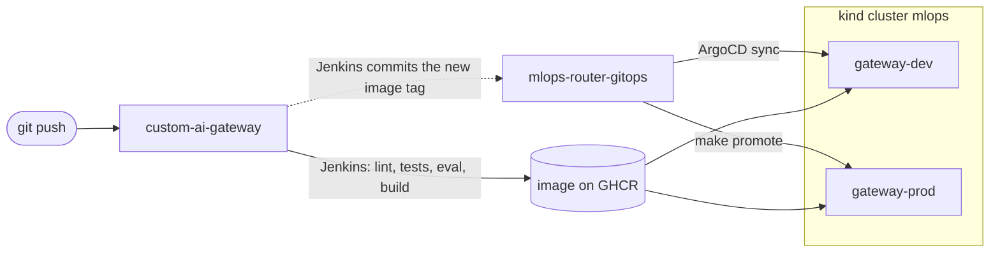

# mlops-skeleton

The **platform** repo. It sets up Kubernetes on your own machine (kind + Jenkins + ArgoCD). That setup tests,
builds and deploys the AI gateway. It also has **drills**: scripts that break the setup on purpose.

There are three repos, cloned next to each other:

| Repo | Holds |
|---|---|
| [`custom-ai-gateway`](https://github.com/ducthangng/custom-ai-gateway) | the product: its code, its tests, its `Jenkinsfile` |
| [`mlops-router-gitops`](https://github.com/ducthangng/mlops-router-gitops) | what should run: Helm chart `ai-gateway`, ArgoCD apps, Jenkins job XML |
| **this repo** | how to set the platform up and how to break it: `Makefile`, `scripts/`, `drills/` |

## The platform



Jenkins runs the tests, using the product's `Jenkinsfile`. It never deploys anything itself. It pushes the image,
then commits the new image tag to the GitOps repo. ArgoCD sees that commit and deploys it.

## Where things are

| Path | What it does |
|---|---|
| `Makefile` | entry point for everything; each target has a `##` comment |
| `scripts/bootstrap.sh` | `make up`: creates the kind cluster, ArgoCD, Jenkins, Secrets and ArgoCD apps. Safe to re-run |
| `scripts/jenkins-configure.sh` | loads the Jenkins jobs from `mlops-router-gitops/jenkins/jobs/*.xml` (`make up` calls it) |
| `scripts/jenkins-clean.sh` | `make jenkins-clean`: deletes Jenkins build history (a dry run unless you add `CONFIRM=1`) |
| `scripts/drill.sh` | runs one drill: `make drill-NN` breaks it, `make drill-NN-fix` restores it |
| `scripts/lib.sh` | helpers shared by the scripts; loads `.env` |
| `drills/` | one file per drill (see below) |
| `tools/logtriage/` | reads a Jenkins log and names the failure; the drills use it |
| `tests/unit/` | tests for `logtriage` (`make test`). The product's tests are in `custom-ai-gateway/gateway/quick_tests` (`make gw-test`) |
| `.env` | `GITHUB_USER`, `GITHUB_PAT` and LLM API keys. Gitignored; copy it from `.env.example` |

Day to day:

```bash
cp .env.example .env                   # fill in GITHUB_PAT (and an LLM key if you have one)
make up                                # bring everything up
make status                            # check that it is healthy
make jenkins | make argocd | make app  # open a UI
make promote                           # copy the dev image tag to prod (a Git commit; you push it)
```

## Drills

Each drill breaks one thing on purpose. You see what that failure looks like and practise fixing it in a safe
place. When the same thing happens for real, you recognise it.

```bash
make drills          # list all drills
make drill-06        # break it; prints what broke and what to look at
make drill-06-fix    # put it back
```

Drills never change your working tree:
- CI drills create a `drill/*` branch in a separate worktree.
- Cluster drills run in their own namespace, `drills`, which ArgoCD does not manage.

| # | What breaks | What you see |
|---|---|---|
| **CI** | | |
| 01 | a unit test fails | the build goes red and nothing is deployed |
| 02 | a lint error | the Lint stage, which runs in parallel, fails on its own |
| 03 | `routes.yaml` routes worse | the routing-accuracy gate blocks the release |
| 10 | the GHCR credentials Secret is missing | branch builds still pass; `main` fails when it pushes the image |
| 11 | Kaniko gets too little memory | the image build is OOMKilled (exit 137) |
| 12 | a flaky test | the same commit passes one time and fails the next |
| 16 | `routes.yaml` loses the keyword `joke` | quick tests stay green, the release check fails `routes_unchanged` |
| **Deploy** | | |
| 04 | a bad image tag in Git | ImagePullBackOff; the old pods keep serving; the fix is `git revert` |
| 05 | a manual `kubectl scale` | ArgoCD resets the replica count to what Git says |
| 14 | the health probe fails | new pods never become Ready and the rollout stalls |
| **Runtime** | | |
| 06 | Redis hangs | the gateway still answers, just without the cache |
| 07 | the pod behind a port-forward is deleted | the port-forward dies; the Service keeps working |
| 08 | Postgres is down | chats fail while `/api/healthz` still reports healthy |
| 09 | an invalid provider API key | the provider's error is shown and logged, and never cached |
| 13 | the gateway gets too little memory | OOMKilled, then CrashLoopBackOff; the old pod keeps serving |
| 15 | an answer is cut off by `max_tokens` | the cut-off answer is not cached |

Longer notes, measured numbers and lessons learned are in [NOTES.md](NOTES.md).
